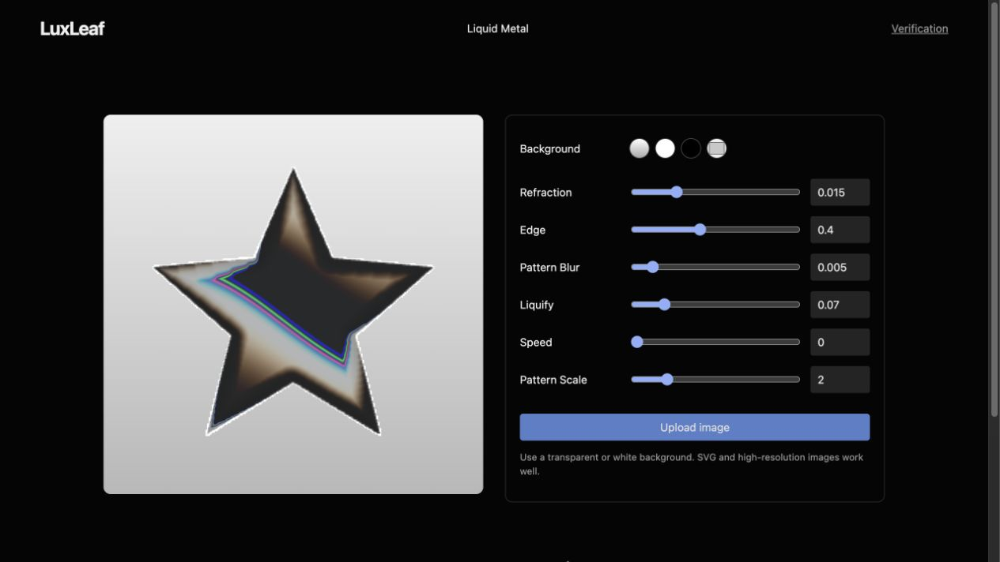

# LuxLeaf Metal Mark — independent liquid editor

**A logo preview, six live effect controls, image intake, and export tools built in original LuxLeaf code.**

[Run the editor](#run-the-editor) · [Renderer example](#renderer-example) · [Controls](#controls) · [Published-package guide](#published-package-guide)



*Actual local editor. [View its source](demo/liquid.tsx). Exact pixel and original server-API equivalence are not established.*

This guide covers the `behavior-parity` branch in [PR #1](https://github.com/Zontafor/luxleaf-metal-mark/pull/1). `LiquidMark` is available in this source branch; it is **not** in the published 0.2.0 registry package. The [main guide](https://github.com/Zontafor/luxleaf-metal-mark/blob/main/README.md) documents that package's `MetalCanvas` and `MetalMark` API.

## Run the editor

Use Node 24+ and a WebGL2-capable browser.

```sh
git clone --branch behavior-parity https://github.com/Zontafor/luxleaf-metal-mark.git
cd luxleaf-metal-mark
npm ci --ignore-scripts
npm run dev
```

Open the Vite URL. Choose a geometric example or upload your own logo. Adjust the six effect controls and preview background. Expand **Export and share** to save PNG, record WebM, save a project or create a bounded share link.

## Renderer example

This browser example uses source imports. Place it in `demo/usage.ts`, load it as a module from a demo HTML page, and supply a mounted `<canvas id="logo" style="width:400px;height:400px"></canvas>`.

```ts
import { LiquidMark, liquidDefaults } from '../src/liquid';

const canvas = document.querySelector<HTMLCanvasElement>('#logo');
if (!canvas) throw new Error('A logo canvas is required');
const renderer = new LiquidMark(canvas, liquidDefaults);
await renderer.example('star');
renderer.update({ refraction: 0.02, liquify: 0.1, speed: 0.2 });

// In your export action: const png = await renderer.exportPNG();
// In your view's teardown: renderer.destroy();
```

For a file selected by the user, use `await renderer.load(file)`. It accepts SVG, PNG, WebP and JPEG within the implementation's size limits. `loadSVG(text)` runs the independent geometry-only decoder. `destroy()` releases the renderer; call it when removing the view.

## Controls

| Control | Observed default | LuxLeaf accepted range |
|---|---|---|
| Refraction | 0.015 | 0–0.06 |
| Edge | 0.400 | 0–1 |
| Pattern Blur | 0.005 | 0–0.05 |
| Liquify | 0.070 | 0–0.4 |
| Speed | 0.300 | 0–1; zero pauses |
| Pattern Scale | 2.0 | 0.1–10 |

The defaults were visible in the reference screenshot. Range limits are LuxLeaf choices. See [the observation record](docs/REFERENCE_BEHAVIOR.md) for what was and was not established.

## Projects and export

`liquidShare()` and `liquidFromShare()` round-trip a validated `LiquidProject` in a URL fragment. Use a project file when the embedded image exceeds the link size limit. The `LiquidProject` schema is distinct from the older SQLite `MetalProject` adapter. Preview backgrounds are CSS; PNG output retains transparency.

| Local route | Purpose | Source |
|---|---|---|
| `/` | Six-control liquid editor | [Editor](demo/liquid.tsx) |
| `/checks-liquid.html` | 18 liquid behavior checks | [Checks](demo/checks-liquid.ts) |
| `/advanced.html` | Previous studio and project workflow | [Studio](demo/advanced.tsx) |

## Verification and license

```sh
npm run verify
npm run verify:package
```

TypeScript, production build and 20 automated tests passed; 18 separate browser checks cover rendering, control effects, image input, export, sharing, GPU errors and disposal. [Validation notes](docs/VALIDATION.md) explain remaining gaps.

Original LuxLeaf code remains under the [Michelle L. Wu proprietary license](LICENSE). No Paper implementation source, shader, parser or brand artwork was copied. Dependencies retain their own [licenses](THIRD_PARTY_NOTICES.md).

## Published-package guide

For installation and working examples of the released `MetalCanvas` and `MetalMark` API, see the [organized main-branch README](https://github.com/Zontafor/luxleaf-metal-mark/blob/main/README.md). The earlier implementation remains in this branch alongside the new editor.
