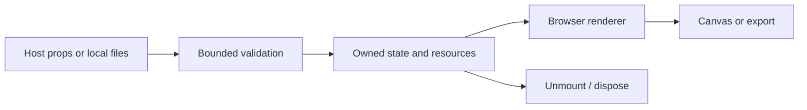

# Architecture — v0.2.0

### Original implementation

No Paper Design source, shader or assets are included. This package is independently implemented; it is not an exact recreation or API-compatible fork of that restricted product.

### Image pipeline

Linear-time distance transform, alpha/luminance masks, bevel normals, bounded local PNG/WebP decoding, and a geometry-only SVG sanitizer/rasterizer.

### Studio and persistence

Directional metal reflections, edge/chromatic controls, PNG and WebM exports, portable embedded-logo projects, undo/redo, bounded fragment sharing, authenticated SQLite project CRUD with expiry and opt-in public reads.

### Remaining host verification

The server is a single-process reference adapter, not an enterprise tenant/auth system. Distributed storage, quotas, host rate limits, HTTPS deployment, independent security assessment and broad device/codec certification remain outside this release.

## Processing flow



## Foundation boundary

LuxLeaf extension code lives in `src/`. Permitted reference source is preserved separately where included. Host-specific adapters are separate entry points. The browser library does not supply application-wide authorization or tenant isolation.

## Earlier core design notes

# LuxLeaf Metal Mark: architecture

```text
Local PNG/WebP → type/size validation → browser image decoder → retained alpha mask → original WebGL2 reflection shader → transparent PNG Blob
```

The original shader evaluates moving sinusoidal reflection bands and combines them with a metallic tint and contrast curve. The uploaded image contributes alpha only. Aspect-correct fitting keeps the entire logo in the canvas. This is an original visual treatment; it does not reproduce Paper Design's shader or edge-distance algorithm.

Files stay in the browser. MIME and size are checked before decoding; the browser validates image data during decoding. Decoded dimensions are checked before texture upload. The dimension limit is after decoding and does not prevent all compressed-image memory pressure. Do not treat this browser convenience API as a server-side untrusted media sanitizer. SVG is intentionally unsupported; neither script-bearing markup nor remote image URLs are accepted.

An image-generation counter makes the latest requested file win and prevents a completed decode from applying after disposal. ImageBitmaps close in a finally block. A local canvas retains decoded pixels for graphics restoration; no file bytes or image data are serialized into presets. A static local image supplies the fallback if WebGL is unavailable or the context is lost. PNG export requires a working renderer and does not silently export a fallback.

`Surface` owns the WebGL2 program, retained texture, uniforms, resize/intersection observers and scheduling. DPR is capped at 2, dimensions at 4096. Reduced motion, hidden documents and offscreen canvases pause automatic frames. Context restoration recompiles the shader and restores the texture; real device restoration is implemented but not verified in this release. `destroy()` releases GPU resources, removes observers/listeners, restores the original background and invalidates pending loads.

Preserved drawing buffers support reliable local PNG capture at a throughput cost. This package contains no cloud upload, animation-video encoder, analytics, billing or account system.

## Trust boundary

Preset JSON enters a strict whitelist validator before it changes rendering state. The library does not evaluate code, render imported HTML, request credentials or contact an application backend. Dependencies are pinned in the lockfile; preserved runtime license texts ship in `third_party/`. Treat dependency installation as a separate network operation from running the demo.

## Integration with LuxLeaf's wider system

This package belongs in the presentation layer. Keep provider credentials, authorization, metering, workflow execution and document access on the existing server side. Store only validated, bounded presets through the host application's authorized tenant-scoped API. Do not infer permissions from visual state or embed secrets in presets. That API connection is an integration contract, not a backend implemented by this repository.

Build the library as ESM and bundle it with the authorized host application. The included demo is a static build in `demo-dist/`; an approved internal static host can serve it. No infrastructure is automatically provisioned and no cloud credentials are required.
