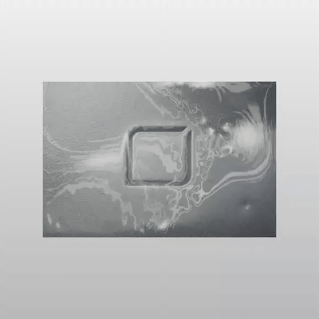
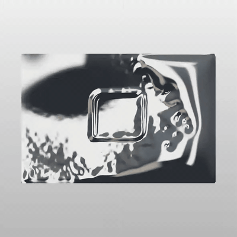

# AULIN — selected demo and artwork modes

## Selected demo

[](media/aulin-demo.mp4)

[MP4](media/aulin-demo.mp4) · [Original WebM](media/aulin-demo.webm) · [Exact capture settings](media/aulin-demo.json) · [Preset source](../demo/aulin-preset.ts)

This is the current demonstration chosen in the live editor on November 1, 2026. It was recorded before the export improvements, preserving the selected appearance. Choose **AULIN demo** to load the supplied artwork and restore this configuration:

| Control | Selected value |
|---|---:|
| Refraction | 0.015 |
| Edge | 0.661 |
| Pattern Blur | 0.05 |
| Liquify | 0.4 |
| Speed | 1 |
| Pattern Scale | 10 |

Artwork mode is **Logo cutout** and the background is **Gradient**. The film is 9.87 seconds at 886 × 886, encoded at 30 fps with no audio. The original WebM and capture hash are retained. Reproduction restores the material settings; the running animation's starting phase varies.

## Full-surface comparison

The supplied `aulin_leather.png` is a textured photograph with an embossed mark. Applying inverse luminance as alpha made its bright regions partly transparent. **Full-image relief** uses the established luminance-derived relief normals while retaining the source alpha, so opaque artwork stays opaque across its entire rectangle.

The existing chrome shader, studio lighting, 48-sample GGX integration and three-wave animation are unchanged. This is a coverage correction with the previous shading style, not a replacement material.

[](media/aulin-full-surface.mp4)

[MP4](media/aulin-full-surface.mp4) · [WebM source](media/aulin-full-surface.webm) · [Capture record](media/aulin-full-surface.json)

## Run and compare

Run `npm run dev`. Select **AULIN full surface** for the continuous chrome photograph, or **AULIN previous look** for the earlier treatment. Both use the original control defaults with Speed 1, matching the supplied local-editor reference. The artwork-mode selector supports Automatic, Logo cutout and Full-image relief. Automatic preserves the previous import behavior; full-image treatment is explicit. SentiLeaf and the geometric examples reset to Automatic when selected.

```ts
import { LiquidMark } from '../src/liquid';
const renderer = new LiquidMark(canvas, { speed: 1 });
renderer.setInputMode('relief');
await renderer.load(file); // the user-selected artwork
// renderer.setInputMode('cutout') reprocesses the retained original image.
```

Projects retain optional `inputMode`; older version-1 projects still load unchanged. PNG and video exports continue to include the chosen preview background. Transparent PNG remains available. The clip was recorded through the actual editor and has no audio.

## Evidence and limits

40 automated tests and 29 browser checks pass. The selected 5.36 MB project now imports successfully, with bounded 8 MiB embedded PNG and 12 MiB JSON limits. Recording locks editable settings, has a Cancel recording button, and cleans up streams/listeners on failure, cancellation, hidden tabs or canvas resize. The numerical regression verifies that full-surface mode preserves the previous relief channels exactly while correcting alpha. GPU checks sample opaque coverage across the interior, show deformation in all four quadrants and verify the previous cutout treatment remains accessible.

Luminance is an artistic relief cue, not recovered physical depth. Photographic lighting, leather grain and embossing are not separable from a single image by this pipeline. The surface motion remains procedural, not fluid dynamics; the reference appearance is a visual target rather than a pixel-equivalence claim. The source artwork was supplied for this demonstration and remains subject to its owner's rights.
