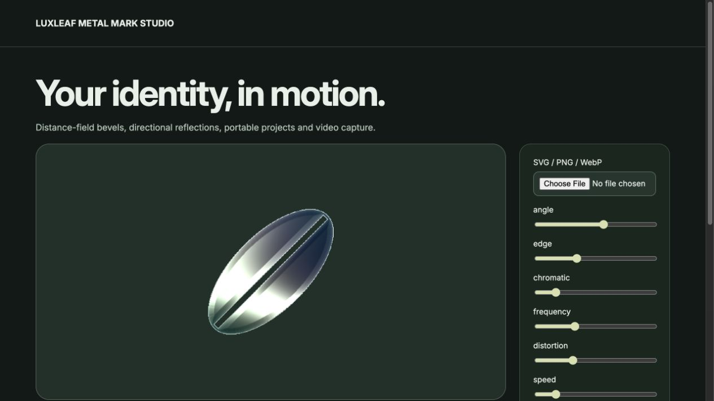

> Historical guide for the previously published 0.2.0 package. The current source editor is described in the [root README](../README.md).

# LuxLeaf Metal Mark

**Turn a logo into animated metal with local image processing, adjustable reflections and export tools.**

[Quick start](#quick-start) · [Examples](#examples) · [API guide](#api-guide) · [Run the demos](#run-the-demos) · [Documentation](#documentation)



*Actual package workbench. [View its source](../demo/advanced.tsx); run `/advanced.html` using the instructions below. This is a screenshot, not a hosted live demo.*

## At a glance

- Independent distance-field logo renderer with directional reflections and chromatic edges.
- Bounded PNG/WebP input plus a geometry-only SVG decoding path.
- React component and imperative renderer with explicit cleanup.
- PNG/WebM export, portable projects, undo/redo and a reference persistence adapter.

**Release covered:** `@zontafor/luxleaf-metal-mark@0.2.0` on `main`. [PR #1](https://github.com/Zontafor/luxleaf-metal-mark/pull/1) contains newer work; its [source-branch guide](https://github.com/Zontafor/luxleaf-metal-mark/blob/behavior-parity/README.md) uses the APIs available on that branch. The examples below use the published package, unless explicitly labeled otherwise.

## Quick start

Node 24+ for this repository; React 19 for the component example; WebGL2 for the animated effect. Use a transparent or white-background logo and give the canvas a visible size.

### Install in an application

Configure GitHub Packages authentication as described in the [release and registry guide](RELEASING.md). Scope the registry to LuxLeaf so other dependencies continue to resolve from their normal registry:

```sh
npm config set @zontafor:registry https://npm.pkg.github.com --location=project
npm install @zontafor/luxleaf-metal-mark@0.2.0
```

Keep credentials outside committed source. [GitHub Releases](https://github.com/Zontafor/luxleaf-metal-mark/releases) also provide package archives; downloading an archive is separate from installing through the registry.

### Try the repository locally

```sh
git clone https://github.com/Zontafor/luxleaf-metal-mark.git
cd luxleaf-metal-mark
npm ci --ignore-scripts
npm run build
npm run dev
```

Open the local address printed by Vite. React examples below belong in a React/TypeScript application; plain TypeScript examples run in a browser with a bundler.

## Examples

### React logo preview

```tsx
import { MetalCanvas } from '@zontafor/luxleaf-metal-mark';

export function BrandPreview() {
  return (
    <MetalCanvas
      options={{ color: '#c6d9cb', speed: 0.3, angle: 25, edge: 1, chromatic: 0.15 }}
      style={{ display: 'block', width: '100%', height: 360 }}
    />
  );
}
```

This starts with the original LuxLeaf leaf shape. Use the workbench to upload a logo and adjust its settings.

### Render an SVG and export PNG

```ts
import { MetalMark } from '@zontafor/luxleaf-metal-mark';

export async function renderLogoPNG(canvas: HTMLCanvasElement): Promise<Blob> {
  const renderer = new MetalMark(canvas, { animate: false, angle: 35, edge: 1.2 });
  try {
    await renderer.loadSVG(`
      <svg xmlns="http://www.w3.org/2000/svg" width="200" height="200" viewBox="0 0 200 200">
        <path fill="black" d="M100 15L185 100L100 185L15 100Z"/>
      </svg>
    `);
    return await renderer.exportPNG();
  } finally {
    renderer.destroy();
  }
}
```

Pass a mounted, sized canvas. The returned Blob can be downloaded or passed to your application. Cleanup runs even if decoding or export fails.

### Validate and save settings

```ts
import { validate, serialize, deserialize } from '@zontafor/luxleaf-metal-mark';

const settings = validate({ angle: 35, edge: 1.2, speed: 0.2, animate: true });
const json = serialize(settings);
const restored = deserialize(json);
console.info(restored.angle); // 35

```

This round-trips renderer settings. To include the logo image and project metadata, use the project helpers demonstrated in the advanced studio.

## API guide

| Entry or symbol | Purpose |
|---|---|
| `MetalCanvas` | React wrapper; options and onReady(renderer) callback. |
| `MetalMark(canvas, options)` | Imperative renderer with update(), load(), loadSVG(), exportPNG() and destroy(). |
| `validate / serialize / deserialize` | Validated settings and JSON round-trip. |
| `recordCanvas / ProjectHistory` | Video recording and reversible project edits. |
| `/server` | Authenticated SQLite reference adapter; deployment controls belong to the host. |

### Common options

| Option | Default | Accepted values |
|---|---|---|
| `color` | `#c6d9cb` | Six-digit hex color |
| `speed / frequency` | `0.3 / 7` | 0–2 / 1–20 |
| `distortion / contrast` | `0.6 / 1.2` | 0–2 / 0.3–3 |
| `angle / edge / chromatic` | `25 / 1 / 0.15` | −180–180 / 0–3 / 0–1 |
| `animate` | `true` | Boolean |

## Run the demos

After `npm run dev`, append a route below to the local Vite address. These links point to checked-in source; GitHub does not execute the demos itself.

| Local route | Example | Source |
|---|---|---|
| `/` | Compact example | [React entry](../demo/main.tsx) |
| `/advanced.html` | Full workbench shown above | [Workbench](../demo/advanced.tsx) |
| `/checks.html` | Base browser checks | [Check page](../demo/checks.html) |
| `/checks-expanded.html` | Expanded browser checks | [Check page](../demo/checks-expanded.html) |

## Development and verification

```sh
npm run verify          # Type checks, tests, build, and foundation checks where defined
npm run verify:package  # Inspect and import the built package archive
```

Open the browser check pages separately and use their Run button. [Validation notes](VALIDATION.md) distinguish automated checks, browser observations and remaining host verification. Passing checks does not certify complete upstream or cross-device parity.

### Integration notes

Metal Mark is independently implemented; exact Paper pixel or API equivalence is not established. In 0.2.0, use loadSVG(text) for SVG and load(file) for PNG/WebP. The newer six-control LiquidMark editor is available only in PR #1, not the published 0.2.0 package.

## Documentation

| Guide | What it covers |
|---|---|
| [Capabilities](CAPABILITIES.md) | Implemented features and current limits |
| [Architecture](ARCHITECTURE.md) | Rendering, state and resource lifecycle |
| [Validation](VALIDATION.md) | Checks and their scope |
| [Releases](RELEASING.md) | Registry authentication, archives and release verification |
| [Provenance](PROVENANCE.md) | Foundation boundaries and original additions |
| [Security](SECURITY.md) | Supported deployment assumptions |
| [Changelog](CHANGELOG.md) | Release history |

## License and attribution

Original LuxLeaf code, documentation and examples are covered by the [proprietary license](../LICENSE), copyright **Michelle L. Wu**. Included third-party software retains its own licenses and authorship; see [third-party notices](../THIRD_PARTY_NOTICES.md). Public repository visibility does not grant rights beyond those licenses.
