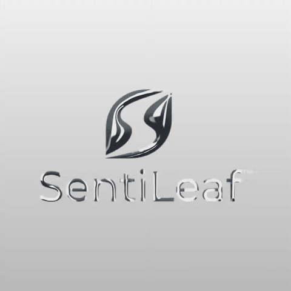

# SentiLeaf — clean logo and matching video background

The default editor now uses the user-provided SentiLeaf logo. Its opaque off-white backdrop previously became a faint reflective rectangle because inverse luminance was used directly as transparency. The corrected input pipeline estimates a uniform border color, removes that backdrop, normalizes foreground coverage and fits the remaining artwork with padding. Existing transparent artwork retains its alpha, including soft edges and holes.

[](media/sentileaf-liquid-metal.mp4)

[MP4 film](media/sentileaf-liquid-metal.mp4) · [Original WebM capture](media/sentileaf-liquid-metal.webm) · [Capture record](media/sentileaf-record.json)

## Reproduce

Run `npm run dev`. SentiLeaf loads automatically with Speed 0.3 and the gray gradient background. Open **Export and share**, then **Export video**. Keep the preview visible during its ten-second capture. Export reports that motion is paused when Speed is zero. PNG and video include the selected background; **Transparent PNG** preserves alpha for compositing. The SDK's `exportPNG()` remains transparent for compatibility.

```ts
import { exportPreviewPNG, recordPreview } from '../src/preview-export';
const png = await exportPreviewPNG(canvas, 'gradient');
const webm = await recordPreview(canvas, '#123456', 10);
```

These helpers are also exported from the package source entry. They are not yet part of the older published registry version.

The checked clip contains 295 frames at 30 fps (9.83 seconds), exported to 960 × 960 from the browser recording. It has no soundtrack. The GIF is a shorter preview, not a seamless loop. Full encoding and frame-change evidence appears in the capture record.

## Validation and limits

30 automated tests and 25 local Chromium browser checks pass. New cases cover colored artwork on off-white, light artwork on dark backgrounds, antialiased edges, holes, transparent white artwork, empty input, and actual solid/gradient background compositing. SentiLeaf is the browser regression fixture.

Background estimation targets transparent artwork or flat backdrops, not arbitrary photographs. Nonuniform opaque backgrounds retain the luminance fallback. Thin lettering still depends on source resolution and the relief grid; this is a visual conductor effect with procedural motion, not a physical liquid simulation. The original uploaded raster remains intact for project export and reprocessing.

The public showcase receives only the recorded SentiLeaf media and descriptive documentation. Renderer source stays private. SentiLeaf artwork is user supplied; this demonstration grants no separate trademark rights.
